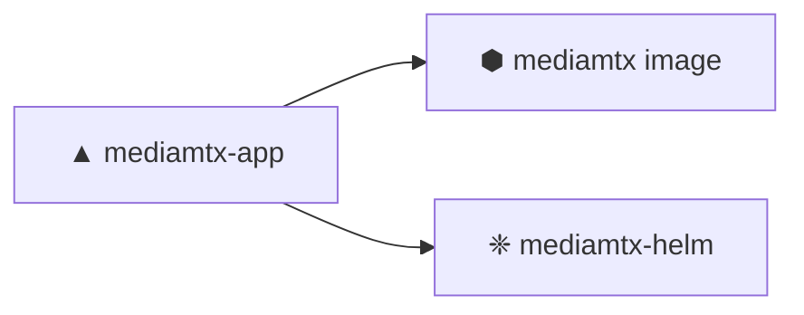

# ▲ MediaMTX App

!!! abstract "At a glance"
    **MediaMTX is a real-time media server and media proxy** for RTSP, RTMP, HLS, WebRTC and SRT — packaged as a Teknoir platform app.

    | Field | Value |
    |-------|-------|
    | Component | `mediamtx-app` |
    | Type | `app` |
    | Owner | `group:teknoir/public` |
    | Lifecycle | `production` |

---

## ✦ What it does

- **Ingest** streams over RTSP, RTMP, SRT or WebRTC.
- **Proxy & remux** between protocols on the fly.
- **Serve** low-latency playback to HLS / WebRTC clients.
- **Loop & replay** local video files via bundled FFmpeg.

## ⚙ Dependencies



- `component:teknoir/docker.io.bluenviron.mediamtx`
- `component:teknoir/mediamtx-helm`

## ▶ Deploy

Deployed to a device through the [Helm chart](helm.md):

```yaml
apiVersion: helm.cattle.io/v1
kind: HelmChart
metadata:
  name: mediamtx
  namespace: default
spec:
  repo: https://teknoir.github.io/mediamtx-helm
  chart: mediamtx
  targetNamespace: default
```
