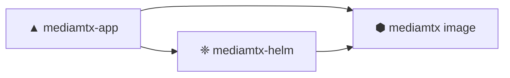

# ◈ MediaMTX // Teknoir

> **Real-time media, at the edge of now.**
> Stream, proxy and record RTSP · RTMP · HLS · WebRTC · SRT — orchestrated by Teknoir.

---

<div class="grid" markdown>

<div class="neo-card" markdown>
### ▲ App
The deployable MediaMTX application on the Teknoir platform.

[Enter →](app.md){ .neo-btn }
</div>

<div class="neo-card" markdown>
### ❈ Helm Chart
Package `mediamtx` `v0.0.4` — one-command deploy to any device.

[Enter →](helm.md){ .neo-btn }
</div>

<div class="neo-card" markdown>
### ⬢ Image
`bluenviron/mediamtx:latest-ffmpeg` — the media engine core.

[Enter →](image.md){ .neo-btn }
</div>

<div class="neo-card" markdown>
### ✶ Add Videos
Ship video container images & loop them into live RTSP streams.

[Enter →](videos.md){ .neo-btn }
</div>

</div>

---

## System map



!!! tip "Fast lane"
    ```bash
    helm repo add teknoir-mediamtx https://teknoir.github.io/mediamtx-helm/
    helm install mediamtx teknoir-mediamtx/mediamtx -f values.yaml
    ```
